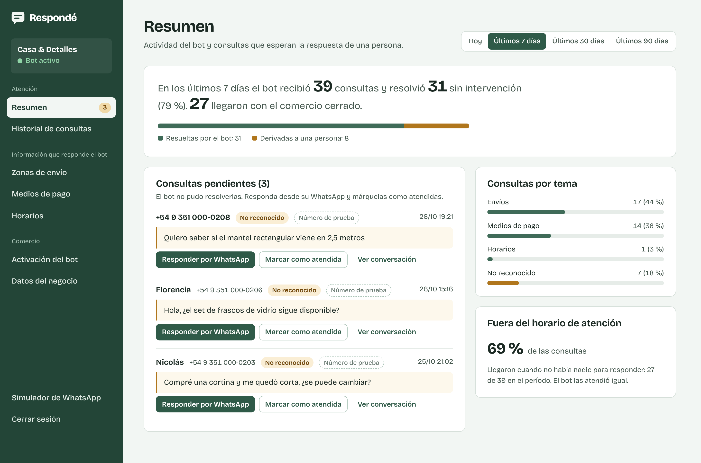

# Plataforma de atención automatizada de consultas frecuentes mediante WhatsApp

Prototipo funcional del proyecto del **Seminario de Práctica de Analista en Software** (Ingeniería en Software,
Universidad Siglo 21, cátedra C, 2026). Autores: Román Cuberli (SOF01923) y Esteban Aguilar (SOF02122).
Docente: Leonardo Gabriel Gamboa.

La plataforma combina un **bot de WhatsApp** y un **panel web de administración** para que comercios minoristas que
venden por mensajería, como Casa & Detalles (caso de estudio), respondan al instante las consultas sobre **envíos,
medios de pago y horarios**. Varios comercios comparten una misma línea de WhatsApp provista por la plataforma; el
código incluido en el primer mensaje del comprador identifica a qué comercio corresponde cada conversación.

El bot entiende errores de tipeo, abreviaturas y varias preguntas en un mismo mensaje; reconoce la ciudad del
comprador; informa plazo y costo del envío; contesta si se acepta un medio de pago puntual; responde las preguntas
frecuentes propias de cada comercio (cambios, factura, retiro, ventas por mayor); ofrece botones; y cuando una
consulta necesita a una persona (productos, pedidos, reclamos, pagos informados) le dice al comprador quién le va a
escribir y cuándo, y la deja pendiente en el panel con su tema. También protege al comprador y al comercio: no
guarda datos de tarjeta, advierte ante estafas, verifica si un alias o un teléfono son del comercio y frena el spam,
los insultos y las ráfagas de mensajes ([seguridad](docs/seguridad.md)).



## Qué incluye

| Caso de uso | Dónde está |
|---|---|
| CU01 Registrarse en la plataforma | `/registro` |
| CU02 Iniciar sesión (con bloqueo tras 5 intentos fallidos durante 15 minutos) | `/ingresar` |
| CU03 Completar onboarding (4 pasos y resumen, retoma el paso pendiente) | `/onboarding` |
| CU04 Administrar zonas de envío (plazo, costo, envío gratis e importación de planilla CSV con vista previa) | `/zonas` |
| CU05 Administrar medios de pago (activar, desactivar, editar, eliminar) | `/medios-de-pago` |
| CU06 Administrar horarios (jornada partida y copia a días hábiles) | `/horarios` |
| CU07 Activar el bot (chat de prueba, código, enlace wa.me, QR, cartel imprimible, pausa) | `/activacion` |
| CU08 a CU12 Atención por WhatsApp (intención, envíos por código postal o ciudad, pagos, horarios, derivación según el tema) | `/webhook/whatsapp` y `/simulador` |
| CU13 Consultar resumen y pendientes (indicadores, prioridad, alertas, avisos en vivo y por correo, «Responder por WhatsApp» con mensaje sugerido) | `/panel` |
| CU14 Consultar historial de consultas (búsqueda, filtros, descarga en CSV, conversación completa y bloqueo de números) | `/historial`, `/bloqueos` |
| CU15 Administrar respuestas propias (plantillas, prueba antes de guardar, usos y sugerencias) | `/respuestas` |
| Cuenta (cambio y recuperación de contraseña, avisos por correo) y ayuda | `/cuenta`, `/recuperar`, `/ayuda` |

Además: simulador de WhatsApp para demos sin Meta, datos de demostración con dos comercios y tres semanas de
actividad, pruebas automatizadas organizadas por caso de uso y un corpus de 379 mensajes reales con el que se mide la
comprensión del bot ([evaluación del bot](docs/evaluacion-del-bot.md)).

## Inicio rápido en Windows

1. Instalar [Python 3.10 o superior](https://www.python.org/downloads/) marcando **«Add python.exe to PATH»**.
2. Hacer doble clic en **`iniciar.bat`**.

El script crea el entorno virtual, instala las dependencias, carga los datos de demostración la primera vez y abre
el navegador en `http://localhost:5000`.

| Usuario de prueba | Contraseña | Comercio |
|---|---|---|
| `demo@casaydetalles.com.ar` | `demo1234` | Casa & Detalles (código `CASA26`) |
| `demo@mundotextil.com.ar` | `demo1234` | Mundo Textil (código `TEXT42`) |

El simulador de WhatsApp está en `http://localhost:5000/simulador`.

## Inicio manual (cualquier sistema)

```bash
python -m venv .venv
# Windows: .venv\Scripts\activate     macOS/Linux: source .venv/bin/activate
pip install -r requirements.txt
copy .env.example .env               # macOS/Linux: cp .env.example .env
flask --app app demo --si            # borra la base y carga la demostración
python serve.py                      # http://localhost:5000
```

Para desarrollo con recarga automática: `flask --app app run --debug`.

### Comandos útiles

| Comando | Para qué |
|---|---|
| `flask --app app crear-tablas` | Crea la base vacía con el catálogo de palabras clave |
| `flask --app app demo --si` | Reinicia la base con los comercios de ejemplo |
| `flask --app app palabras listar --tema ENVIO` | Lista las palabras clave de un tema |
| `flask --app app palabras agregar "puf" PRODUCTOS` | Agrega una palabra clave al catálogo |
| `flask --app app admin comercios` | Administración: comercios, contraseñas, bloqueos, pausas, borrado de datos, respaldos y verificación de la configuración ([docs/operacion.md](docs/operacion.md)) |
| `python -m pytest` | Corre las pruebas (instalar antes `requirements-dev.txt`) |
| `python scripts/verificar.py` | Verificación local antes de cada push: análisis estático, formato, pruebas y cobertura (con `--versiones 3.10 3.11 3.12 3.13 --auditoria`, en cada versión de Python y con auditoría de dependencias) |
| `python scripts/evaluar_bot.py` | Informa la exactitud del bot sobre los corpus de mensajes |
| `python scripts/capturas.py` | Regenera las capturas de `docs/capturas` (requiere Playwright) |

## Conectar WhatsApp

El prototipo funciona completo con el simulador. Para atender mensajes reales con el número de prueba de Meta, seguir
[docs/configuracion-whatsapp.md](docs/configuracion-whatsapp.md): se completan cinco variables en `.env`, se expone el
servidor con un túnel HTTPS y se registra la URL del webhook en Meta.

## Publicarla sin costo

[docs/operacion.md](docs/operacion.md) compara tres opciones gratuitas (computadora propia con túnel de Cloudflare,
PythonAnywhere y Docker), explica cada una paso a paso y resume la administración por consola, los respaldos y la
retención de datos. Antes de abrirla al público, `flask --app app admin verificar` revisa la configuración.

## Correo (opcional, sin costo)

Los avisos de consultas pendientes y la recuperación de contraseña usan correo. Por defecto (`MAIL_MODO=archivo`)
cada correo se guarda en `instance/correos` y se abre con cualquier programa de correo, sin enviar nada. Para enviarlos
de verdad alcanza una cuenta de Gmail con una contraseña de aplicación: `MAIL_MODO=smtp`, `MAIL_SERVIDOR=smtp.gmail.com`,
`MAIL_USUARIO`, `MAIL_CONTRASENA` y `URL_PUBLICA` con la dirección del panel (ver `.env.example`).

## Tecnología

Python 3.10+, Flask 3, SQLite (SQLAlchemy 2), WhatsApp Business Platform (Cloud API), Jinja, CSS y JavaScript sin
dependencias externas (funciona sin conexión a internet salvo la integración con WhatsApp), Waitress como servidor
compatible con Windows y pytest para las pruebas.

## Estructura

```
app/
  modelos.py            Clases del dominio (diagrama de clases) mapeadas a las tablas del DER
  bot/                  Motor del bot: normalización, léxico, localidades, intención, estados, respuestas, servicio
  migraciones.py        Migraciones del esquema de la base
  mensajeria/           Cliente de WhatsApp Cloud API y lectura del webhook
  servicios/            Reglas del panel: cuentas, zonas, medios de pago, horarios, métricas
  web/                  Rutas (una por caso de uso), webhook y simulador
  templates/, static/   Interfaz del panel
  datos/                Catálogo de palabras clave, datos del caso de estudio y de la demostración
tests/                  Pruebas por caso de uso y corpus de evaluación del bot (tests/corpus)
scripts/                Verificación local, evaluación del bot y capturas
docs/                   Arquitectura, manual de uso, configuración de WhatsApp, casos de prueba y capturas
```

## Documentación

- [Arquitectura y decisiones de implementación](docs/arquitectura.md)
- [Manual de uso del panel](docs/manual-de-uso.md)
- [Configuración de WhatsApp Business Platform](docs/configuracion-whatsapp.md)
- [Despliegue y operación](docs/operacion.md)
- [Casos de prueba](docs/casos-de-prueba.md)
- [Evaluación del bot](docs/evaluacion-del-bot.md)
- [Seguridad: modelo de amenazas del bot y de la aplicación web](docs/seguridad.md)
- [Revisión por perfiles de usuario](docs/revision-por-perfiles.md)
- [Capturas de la interfaz](docs/capturas)
- [Registro de cambios](CHANGELOG.md), [guía de contribución](CONTRIBUTING.md) y [política de seguridad](SECURITY.md)

## Alcance del prototipo

Respeta lo delimitado en el informe: clasificación por palabras clave (sin procesamiento de lenguaje natural), un único
usuario por comercio, sin consulta de stock, sin cobros, sin seguimiento de envíos, un solo canal (WhatsApp) y línea
provista por la plataforma. Esas funciones quedan como requerimientos candidatos (RC01 a RC04). Las respuestas
propias (CU15) no son un constructor de flujos: cada una es una respuesta fija a una pregunta, reconocida por palabras
clave como el resto del bot.
