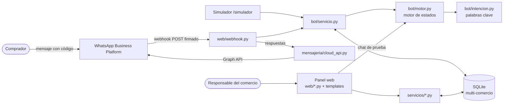
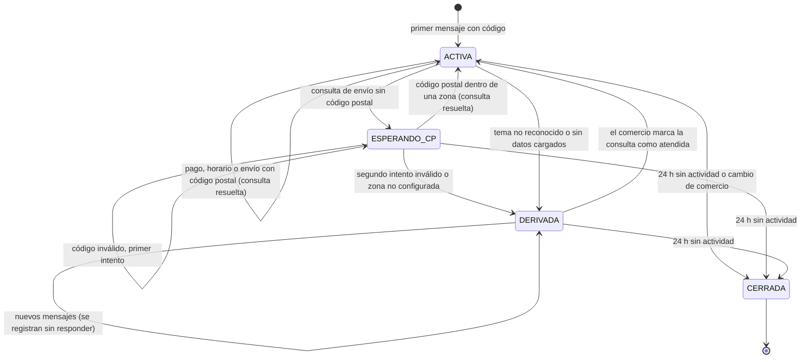
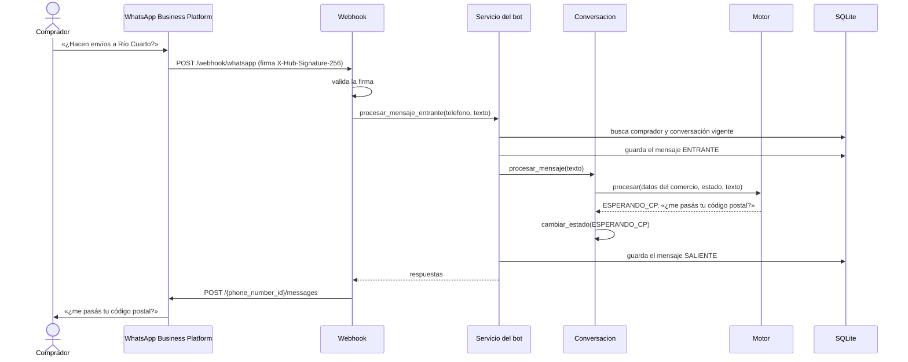

# Arquitectura y decisiones de implementación

Este documento describe cómo el prototipo implementa el diseño de la Entrega 3 (apartados 6.1.3, 7.1.1 y 7.1.2 del
informe) y registra las decisiones tomadas durante la construcción que conviene reflejar en la próxima entrega.

## Vista general

El backend es una única aplicación Flask con dos canales de entrada, como en la Figura 4 del informe:

- **Canal del comprador.** WhatsApp envía cada mensaje al webhook (`/webhook/whatsapp`). El servicio del bot identifica
  el comercio, sostiene la conversación, aplica el motor de estados y guarda mensajes y consultas. Las respuestas se
  envían por la Graph API. El simulador usa exactamente el mismo servicio, sin pasar por Meta.
- **Canal del responsable.** El panel web (Jinja, CSS y JavaScript propios) usa los servicios del panel, que validan
  y guardan la información con la que responde el bot.

## Capas

| Capa | Módulos | Responsabilidad |
|---|---|---|
| Presentación | `app/web/`, `app/templates/`, `app/static/` | Rutas HTTP por caso de uso, formularios, simulador |
| Servicios | `app/servicios/`, `app/bot/servicio.py`, `app/bot/prueba.py` | Reglas de negocio y validaciones |
| Dominio | `app/modelos.py`, `app/bot/motor.py`, `app/bot/intencion.py` | Clases del dominio y lógica conversacional |
| Integración | `app/mensajeria/cloud_api.py` | WhatsApp Cloud API: envío, firma y lectura de eventos |
| Datos | SQLite mediante SQLAlchemy | Persistencia con separación por `id_comercio` |

El motor (`bot/motor.py`) no accede a la base: recibe una copia de los datos del comercio (`bot/contexto.py`) y el
estado de la conversación, y devuelve el nuevo estado, las respuestas y la consulta a registrar. Por eso el mismo
código atiende WhatsApp, el simulador y el chat de prueba del panel, y se prueba sin base de datos.

## Del diagrama de clases al código

Cada clase del diagrama (Figura 6) es un modelo en `app/modelos.py` y cada modelo usa el nombre de tabla y de
columnas del DER (Figura 7). Las operaciones del diagrama se escriben en snake_case:

| Clase | Operación del diagrama | Implementación |
|---|---|---|
| Usuario | `autenticar(email, contrasena)` | `Usuario.autenticar` (contraseña con hash de Werkzeug) |
| Comercio | `generarEnlaceAcceso()` | `Comercio.generar_enlace_acceso(numero_linea)` |
| Comercio | `activarBot()` | `Comercio.activar_bot()` |
| Comercio | `estaAbierto(fechaHora)` | `Comercio.esta_abierto(fecha_hora)` |
| ZonaEnvio | `contiene(cp)` | `ZonaEnvio.contiene(cp)` |
| Conversacion | `procesarMensaje(texto)` | `Conversacion.procesar_mensaje(...)`, que delega en el motor |
| Conversacion | `cambiarEstado(e)` | `Conversacion.cambiar_estado(estado)` |
| Consulta | `marcarAtendida()` | `Consulta.marcar_atendida(fecha_hora)` |
| PalabraClave | `coincide(texto)` | `PalabraClave.coincide(texto)` |

Las cinco enumeraciones (`EstadoComercio`, `TemaConsulta`, `EstadoConversacion`, `ResultadoConsulta`,
`DireccionMensaje`) se guardan como texto con un conjunto acotado de valores, como indica el informe.

## Estados de la conversación

Este diagrama sirve de base para el diagrama de transición de estados que pide la Actividad 4.

## Recorrido de un mensaje (secuencia)

## Aislamiento entre comercios (RF13)

- Toda lectura del panel parte del comercio de la sesión. Los registros se obtienen con `del_comercio()`, que
  devuelve 404 si el registro pertenece a otro comercio.
- Las consultas se filtran por `conversacion.id_comercio`.
- Las pruebas de `tests/test_aislamiento.py` verifican que un comercio no pueda ver, editar ni eliminar zonas,
  medios de pago o consultas de otro.

## Decisiones de implementación a reflejar en el informe

Surgieron al construir el prototipo. Ninguna cambia los casos de uso; precisan detalles que el modelo no fijaba.

**Columnas agregadas al DER**

| Tabla | Columna | Motivo |
|---|---|---|
| usuario | `intentos_fallidos`, `bloqueado_hasta` | Bloqueo de cinco intentos durante quince minutos (CU02) |
| comercio | `paso_onboarding` | Retomar el onboarding en el paso pendiente (CU03, flujo alternativo) |
| conversacion | `intentos_cp` | Contar los códigos postales inválidos antes de derivar (CU09, excepción) |
| mensaje | `id_externo` | Identificador de WhatsApp para descartar eventos repetidos por Meta |

**Comportamiento del bot**

1. **Bienvenida.** El primer mensaje del enlace («Hola, quiero hacer una consulta a … Código: …») no contiene un tema.
   En lugar de derivarlo, el bot responde con una bienvenida que lista los tres temas, sin registrar consulta.
   También responde la bienvenida a un saludo («hola», «buenas tardes»).
2. **Menú numérico.** La bienvenida ofrece las opciones 1, 2 y 3, que equivalen a envíos, medios de pago y horarios.
3. **Cortesía.** «Gracias», «ok», «dale» o un emoji reciben una respuesta amable y no se derivan.
4. **Código escrito a mano.** El código de acceso se reconoce aunque el comprador lo escriba sin usar el enlace.
5. **Cambio de comercio.** Si un comprador con una conversación abierta escribe con el código de otro comercio, la
   conversación anterior se cierra y se abre una nueva con el comercio indicado.
6. **Cierre por inactividad.** Una conversación sin mensajes durante 24 horas pasa a CERRADA (el mismo plazo de la
   ventana de atención de WhatsApp). Es configurable con `CONVERSACION_HORAS_INACTIVIDAD`.
7. **Comprador que vuelve sin el enlace.** Si no tiene una conversación vigente ni escribe un código, se le abre una
   conversación nueva con el último comercio con el que habló. Sin historial previo se aplica la excepción de CU08.
8. **Código postal.** Se aceptan 4 dígitos (1000 a 9999) o el formato CPA (X5000ABC); se ignoran montos como «$1500».
9. **Sin datos cargados.** Si falta la información de un tema (por ejemplo, el comercio desactivó todos los medios de
   pago), la consulta se deriva, como indican las excepciones de CU09 a CU11.
10. **Chat de prueba (CU07).** Usa el mismo motor pero no guarda nada. Si una consulta se derivaría, lo avisa con una
    nota y vuelve a responder normalmente para que el responsable pueda seguir probando.

**Panel**

- El código de acceso tiene 6 caracteres sin letras ni números ambiguos (0, O, 1, I, L) y siempre combina letras y
  dígitos, para no confundirse con palabras. Reactivar el bot conserva el código.
- Mientras no se configura el número de la línea, el enlace y el QR apuntan al simulador.
- Las fechas se guardan en hora de Argentina (`America/Argentina/Cordoba`).
- El chat de prueba, el simulador y la conversación del historial muestran los mensajes desde el punto de vista de
  quien mira: en el simulador el comprador está a la derecha; en el historial, el comercio.

## Seguridad

- Contraseñas con hash (Werkzeug), mensaje genérico ante credenciales inválidas y bloqueo por intentos (CU02).
- Protección CSRF en todos los formularios y en las llamadas del chat y del simulador. El webhook está exento, pero
  exige la firma `X-Hub-Signature-256` de Meta cuando se configura `WHATSAPP_APP_SECRET`.
- Cookies de sesión `HttpOnly` y `SameSite=Lax`; clave secreta aleatoria generada en `instance/` si no se define.
- Redirecciones solo a rutas internas; el simulador solo acepta números de prueba (549 351 0XXXXXX, que no son
  asignables en Argentina) y se desactiva con `SIMULADOR_HABILITADO=false`.

## Limitaciones conocidas del prototipo

- SQLite y un único proceso alcanzan para el alcance del seminario; con varios comercios activos en producción
  convendría PostgreSQL y una cola para procesar los mensajes fuera del webhook.
- El número de prueba de Meta solo envía mensajes a hasta cinco números registrados.
- La respuesta humana se hace fuera del sistema, desde el WhatsApp del comercio (decisión del informe).
