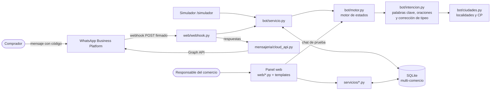
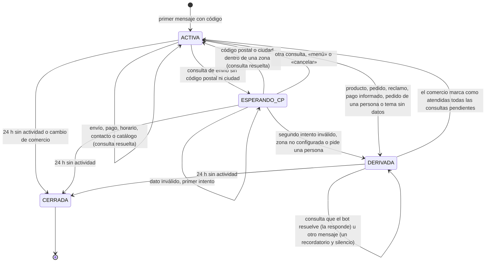
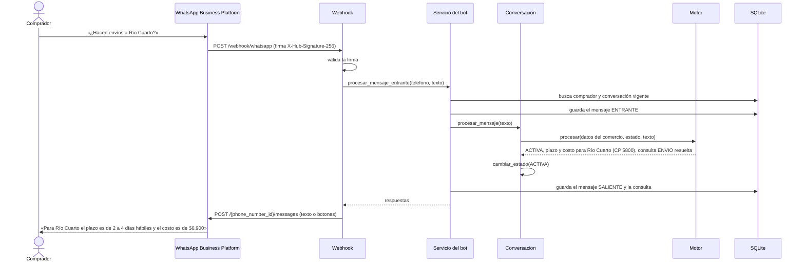

# Arquitectura y decisiones de implementación

Este documento describe cómo el prototipo implementa el diseño de la Entrega 3 (apartados 6.1.3, 7.1.1 y 7.1.2 del
informe) y registra las decisiones tomadas durante la construcción que conviene reflejar en la próxima entrega.

## Vista general

El backend es una única aplicación Flask con dos canales de entrada, como en la Figura 4 del informe:

- **Canal del comprador.** WhatsApp envía cada mensaje al webhook (`/webhook/whatsapp`). El servicio del bot identifica
  el comercio, sostiene la conversación, aplica el motor de estados y guarda mensajes y consultas. Las respuestas se
  envían por la Graph API. El simulador usa exactamente el mismo servicio, sin pasar por Meta.
- **Canal del responsable.** El panel web (Jinja, CSS y JavaScript propios) usa los servicios del panel, que validan
  y guardan la información con la que responde el bot.

## Capas

| Capa | Módulos | Responsabilidad |
|---|---|---|
| Presentación | `app/web/`, `app/templates/`, `app/static/` | Rutas HTTP por caso de uso, formularios, simulador |
| Servicios | `app/servicios/`, `app/bot/servicio.py`, `app/bot/prueba.py` | Reglas de negocio y validaciones |
| Dominio | `app/modelos.py`, `app/bot/motor.py`, `app/bot/intencion.py`, `app/bot/lexico.py`, `app/bot/ciudades.py` | Clases del dominio y lógica conversacional |
| Integración | `app/mensajeria/cloud_api.py` | WhatsApp Cloud API: envío, firma y lectura de eventos |
| Datos | SQLite mediante SQLAlchemy, `app/migraciones.py` | Persistencia con separación por `id_comercio` y migraciones del esquema |

El motor (`bot/motor.py`) no accede a la base: recibe una copia de los datos del comercio (`DatosComercio`) y el
contexto de la conversación (`ContextoConversacion`: estado, intentos, último tema y consultas pendientes), y devuelve
el nuevo contexto, las respuestas y las consultas a registrar. También devuelve la lista de acciones que tomó
(`ENVIO`, `PAGO`, `D:RECLAMOS`, `ACLARA`…): es la traza que se guarda en el log y la que se compara contra el corpus
de evaluación. Por eso el mismo código atiende WhatsApp, el simulador y el chat de prueba del panel, y se prueba sin
base de datos.

## Cómo entiende el bot un mensaje

El alcance del informe excluye el procesamiento de lenguaje natural, así que la comprensión se basa en reglas
deterministas que se pueden explicar y probar (`bot/intencion.py`):

1. **Oraciones.** El mensaje se divide por signos («?», «.», «,») y conectores («y», «también»). Cada oración se
   analiza por separado, así «¿Envían a Rosario? ¿Y cómo se paga?» son dos consultas y se responden las dos.
2. **Normalización** (`bot/normalizacion.py`). Minúsculas, sin tildes ni signos, letras repetidas reducidas
   («holaaa») y abreviaturas de WhatsApp expandidas («q», «x», «hs», «mp», «finde»).
3. **Corrección de tipeo.** Una palabra que no está en el vocabulario se corrige hacia la palabra clave más parecida
   si hay una sola a distancia de edición 1 (o 2 en palabras de 9 letras o más): «orario» → «horario»,
   «trasferencia» → «transferencia». Las palabras comunes del español nunca se corrigen (`bot/lexico.py`).
4. **Coincidencias.** Se buscan los términos de la tabla `palabra_clave` y el vocabulario conversacional (saludos,
   pedido de una persona, «sos un bot?», «menú», «cancelar»). Se elige la combinación que cubre más palabras con
   frases largas: «número de seguimiento» gana sobre «el número», y frases neutras como «tarjeta de dedicatoria»
   evitan falsos positivos.
5. **Puntaje por tema.** Cada término suma su peso (`palabra_clave.peso`). Quedan los temas que superan el umbral y
   algunos absorben a otros: un reclamo que menciona el pedido es un reclamo; un pago informado que menciona la
   transferencia no pregunta por medios de pago; el precio junto a un envío es el costo del envío.
6. **Datos.** Se extraen códigos postales (descartando montos, teléfonos, tarjetas y números de pedido) y
   localidades (`bot/ciudades.py`: 187 localidades con su código postal de referencia, más las provincias y 27
   nombres repetidos en varias provincias, que se marcan como ambiguos).

La exactitud se mide contra dos corpus de mensajes y se informa en `docs/evaluacion-del-bot.md`.

## Del diagrama de clases al código

Cada clase del diagrama (Figura 6) es un modelo en `app/modelos.py` y cada modelo usa el nombre de tabla y de
columnas del DER (Figura 7). Las operaciones del diagrama se escriben en snake_case:

| Clase | Operación del diagrama | Implementación |
|---|---|---|
| Usuario | `autenticar(email, contrasena)` | `Usuario.autenticar` (contraseña con hash de Werkzeug) |
| Comercio | `generarEnlaceAcceso()` | `Comercio.generar_enlace_acceso(numero_linea)` |
| Comercio | `activarBot()` | `Comercio.activar_bot()` |
| Comercio | `estaAbierto(fechaHora)` | `Comercio.esta_abierto(fecha_hora)` |
| ZonaEnvio | `contiene(cp)` | `ZonaEnvio.contiene(cp)` |
| Conversacion | `procesarMensaje(texto)` | `Conversacion.procesar_mensaje(...)`, que delega en el motor |
| Conversacion | `cambiarEstado(e)` | `Conversacion.cambiar_estado(estado)` |
| Consulta | `marcarAtendida()` | `Consulta.marcar_atendida(fecha_hora)` |
| PalabraClave | `coincide(texto)` | `PalabraClave.coincide(texto)` |

Las cinco enumeraciones (`EstadoComercio`, `TemaConsulta`, `EstadoConversacion`, `ResultadoConsulta`,
`DireccionMensaje`) se guardan como texto con un conjunto acotado de valores, como indica el informe.

## Estados de la conversación

Además del estado, la conversación guarda un contexto chico que el motor usa entre mensajes: los intentos de código
postal, los mensajes seguidos sin entender, el último tema y el último código postal (para entender «¿y cuánto
sale?» o «¿y a Mendoza?»).

Este diagrama sirve de base para el diagrama de transición de estados que pide la Actividad 4.

## Recorrido de un mensaje (secuencia)

## Aislamiento entre comercios (RF13)

- Toda lectura del panel parte del comercio de la sesión. Los registros se obtienen con `del_comercio()`, que
  devuelve 404 si el registro pertenece a otro comercio.
- Las consultas se filtran por `conversacion.id_comercio`.
- Las pruebas de `tests/test_aislamiento.py` verifican que un comercio no pueda ver, editar ni eliminar zonas,
  medios de pago o consultas de otro.

## Decisiones de implementación a reflejar en el informe

Surgieron al construir el prototipo. Ninguna cambia los casos de uso; precisan detalles que el modelo no fijaba.

**Columnas agregadas al DER**

| Tabla | Columna | Motivo |
|---|---|---|
| usuario | `intentos_fallidos`, `bloqueado_hasta` | Bloqueo de cinco intentos durante quince minutos (CU02) |
| comercio | `paso_onboarding` | Retomar el onboarding en el paso pendiente (CU03, flujo alternativo) |
| conversacion | `intentos_cp` | Contar los códigos postales inválidos antes de derivar (CU09, excepción) |
| conversacion | `intentos_sin_entender`, `ultimo_tema`, `ultimo_cp` | Aclaraciones antes de dejar de responder y preguntas encadenadas («¿y cuánto sale?») |
| comercio | `envio_gratis_desde`, `enlace_catalogo` | Monto para el envío gratis y enlace al catálogo que comparte el bot |
| zona_envio | `costo` | Costo del envío por zona; vacío si no se informa, 0 si es gratis (CU09) |
| mensaje | `id_externo` | Identificador de WhatsApp para descartar eventos repetidos por Meta |
| mensaje | `botones` | Opciones que acompañaron una respuesta (botones de WhatsApp), para mostrarlas en el historial |
| palabra_clave | `peso` | Peso del término en la identificación del tema (CU08, paso 5) |

**Temas de consulta agregados.** La enumeración `TemaConsulta` suma CONTACTO, PRODUCTOS, PEDIDOS, RECLAMOS y
PAGOS_INFORMADOS. Antes todo eso quedaba como «no reconocido»; distinguirlo permite que el mensaje al comprador
corresponda al caso y que el comercio priorice los pendientes (un reclamo o un pago informado antes que una pregunta
de stock). NO_RECONOCIDO se muestra como «Otras consultas».

**Migraciones.** `app/migraciones.py` agrega las columnas nuevas a una base existente (con `ALTER TABLE`) y lleva la
versión del esquema en `PRAGMA user_version`. Cada versión que cambia el catálogo de palabras clave lo sincroniza:
agrega los términos nuevos y actualiza el tema y el peso de los que trae la aplicación, sin tocar los que agregó el
operador.

**Comportamiento del bot**

1. **Bienvenida.** El primer mensaje del enlace («Hola, quiero hacer una consulta a … Código: …») no contiene un tema.
   En lugar de derivarlo, el bot responde con una bienvenida que presenta los temas, sin registrar consulta. Si el
   comprador agregó una consulta al texto del enlace, el bot se presenta en una línea y la responde.
2. **Botones.** La bienvenida y las aclaraciones llevan botones de respuesta rápida de WhatsApp (hasta tres). Si
   WhatsApp rechaza el mensaje interactivo, se reenvía como texto con la instrucción para escribir la opción. Las
   opciones también se pueden escribir: 1 envíos, 2 medios de pago, 3 horarios, 4 hablar con una persona.
3. **Cortesía e identidad.** «Gracias», «ok», «chau» o un emoji reciben una respuesta amable y no se derivan.
   «¿Sos un bot?» se responde con honestidad: es un asistente automático y se puede pedir una persona.
4. **Código escrito a mano.** El código de acceso se reconoce aunque el comprador lo escriba sin usar el enlace. El
   texto del enlace se reconoce aunque el comercio haya cambiado de nombre después de compartirlo.
5. **Cambio de comercio.** Si un comprador con una conversación abierta escribe con el código de otro comercio, la
   conversación anterior se cierra y se abre una nueva con el comercio indicado.
6. **Cierre por inactividad.** Una conversación sin mensajes durante 24 horas pasa a CERRADA (el mismo plazo de la
   ventana de atención de WhatsApp). Es configurable con `CONVERSACION_HORAS_INACTIVIDAD`.
7. **Comprador que vuelve sin el enlace.** Si no tiene una conversación vigente ni escribe un código, se le abre una
   conversación nueva con el último comercio con el que habló. Sin historial previo se aplica la excepción de CU08.
8. **Código postal o ciudad.** Se aceptan 4 dígitos (1000 a 9999), el formato CPA (X5000ABC) o el nombre de la
   localidad. Se descartan montos («$1500», «1.500»), teléfonos, números de tarjeta y de pedido. Si la localidad se
   repite en varias provincias («San Martín») o es «Buenos Aires» sin más datos, el bot pide el código postal sin
   contarlo como intento fallido. Si se nombra una provincia, se toma su capital como referencia y se aclara.
9. **Costo del envío.** Si la zona tiene costo cargado, el bot lo informa junto al plazo, con el monto para el envío
   gratis si existe. Si el comprador pregunta el costo y la zona no lo tiene, responde el plazo y deriva el costo.
10. **Medios de pago.** Si se pregunta por un medio en particular («¿aceptan Naranja?»), el bot contesta sí o no
    antes del listado. Solo dice que no cuando surge de los datos cargados: si el comercio cargó «Tarjeta de crédito»
    sin nombrar marcas, responde que no tiene ese dato y ofrece consultar a una persona.
11. **Horarios.** Responde el día puntual por el que se pregunta («los sábados», «mañana», «hoy») antes del horario
    completo, y aclara que los feriados pueden variar.
12. **Varias consultas en un mensaje.** Se responden las que el bot resuelve y se deriva el resto, con una consulta
    registrada por tema.
13. **Derivación según el tema.** Productos y precios (con el enlace al catálogo), pedidos (pide el número de
    pedido), reclamos (con prioridad), pagos informados (el pago se verifica antes de confirmarlo) y pedido de una
    persona tienen su propio mensaje. Todos indican el WhatsApp desde el que va a escribir el comercio y cuándo:
    a la brevedad si está en horario o, si está cerrado, desde la próxima apertura («mañana desde las 9:00»).
14. **Derivación sin bloqueo (cambia el flujo alternativo de CU12).** Mientras una consulta está derivada, el bot
    sigue respondiendo lo que sabe resolver (envíos, pagos, horarios) y registra como otra derivación un tema nuevo
    (por ejemplo, un pago informado después de una pregunta de stock). A los demás mensajes les responde una sola
    vez con un recordatorio de que una persona va a escribir y después no responde. La respuesta humana llega desde
    el WhatsApp del comercio, otro número, así que el bot no interfiere con ella; dejarlo mudo hacía esperar al
    comprador por preguntas que se responden solas. La conversación vuelve a ACTIVA cuando el comercio marca como
    atendidas todas sus consultas pendientes.
15. **Mensajes que no entiende.** Ante un mensaje sin sentido («jajaja», «asdf») el bot pide aclaración ofreciendo
    las opciones y una persona; al segundo seguido, ofrece directamente una persona; al tercero deja de responder
    hasta que llegue un mensaje que entienda. Una pregunta con contenido que no es ningún tema («¿hacen envoltorio
    para regalo?») se deriva directamente.
16. **Imágenes, audios y ubicaciones.** El bot no puede ver imágenes ni escuchar audios. Ante una imagen o un
    documento (suelen ser comprobantes o fotos de productos) avisa que no puede verlos, indica el WhatsApp del
    comercio para enviarlos y deriva. Ante un audio pide que escriban la consulta. Ante una ubicación pide el código
    postal. Un texto que acompaña la imagen se entiende como cualquier mensaje.
17. **Sin datos cargados.** Si falta la información de un tema (por ejemplo, el comercio desactivó todos los medios de
    pago), la consulta se deriva, como indican las excepciones de CU09 a CU11.
18. **Chat de prueba (CU07).** Usa el mismo motor pero no guarda nada. Si una consulta se derivaría, lo avisa con una
    nota y vuelve a la atención automática para que el responsable pueda seguir probando.

**Panel**

- El código de acceso tiene 6 caracteres sin letras ni números ambiguos (0, O, 1, I, L) y siempre combina letras y
  dígitos, para no confundirse con palabras. Reactivar el bot conserva el código.
- Mientras no se configura el número de la línea, el enlace y el QR apuntan al simulador.
- Las fechas se guardan en hora de Argentina (`America/Argentina/Cordoba`).
- El chat de prueba, el simulador y la conversación del historial muestran los mensajes desde el punto de vista de
  quien mira: en el simulador el comprador está a la derecha; en el historial, el comercio. Los tres muestran el
  formato de WhatsApp (negrita y enlaces) y las opciones que acompañaron cada respuesta.
- El costo del envío y el monto para el envío gratis se escriben como los escribe un comercio («7900», «7.900»,
  «$ 7.900,00»). La planilla de zonas admite una columna opcional `costo`.
- El enlace al catálogo acepta una dirección web o un usuario de Instagram («@casaydetalles»). Solo se aceptan
  direcciones http o https.
- Los datos de Casa & Detalles están en un solo lugar (`app/datos/casa_y_detalles.py`) y los usan la demostración, la
  conversación de ejemplo de la página de inicio (generada con el motor real) y el corpus de evaluación.

## Seguridad

- Contraseñas con hash (Werkzeug), mensaje genérico ante credenciales inválidas y bloqueo por intentos (CU02).
- Protección CSRF en todos los formularios y en las llamadas del chat y del simulador. El webhook está exento, pero
  exige la firma `X-Hub-Signature-256` de Meta cuando se configura `WHATSAPP_APP_SECRET`.
- Cookies de sesión `HttpOnly` y `SameSite=Lax`; clave secreta aleatoria generada en `instance/` si no se define.
- Redirecciones solo a rutas internas; el simulador solo acepta números de prueba (549 351 0XXXXXX, que no son
  asignables en Argentina) y se desactiva con `SIMULADOR_HABILITADO=false`.

## Limitaciones conocidas del prototipo

- SQLite y un único proceso alcanzan para el alcance del seminario; con varios comercios activos en producción
  convendría PostgreSQL y una cola para procesar los mensajes fuera del webhook.
- El número de prueba de Meta solo envía mensajes a hasta cinco números registrados.
- La respuesta humana se hace fuera del sistema, desde el WhatsApp del comercio (decisión del informe).
