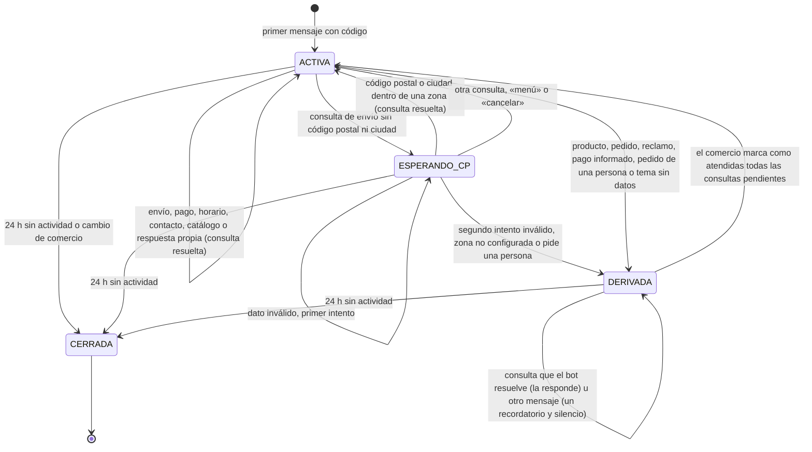
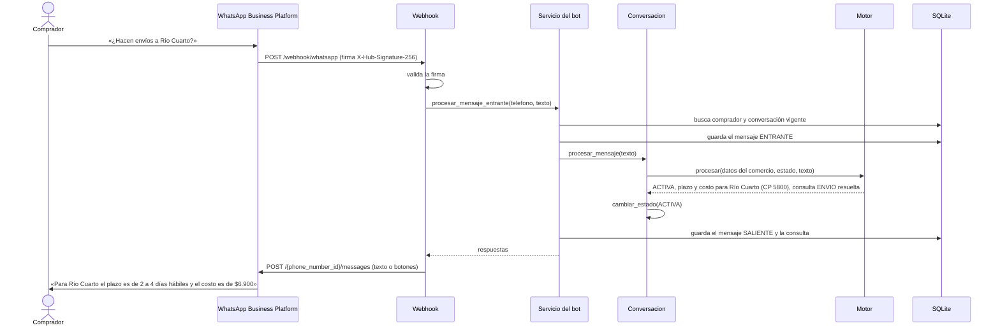

# Arquitectura y decisiones de implementación

Este documento describe cómo el prototipo implementa el diseño de la Entrega 3 (apartados 6.1.3, 7.1.1 y 7.1.2 del
informe) y registra las decisiones tomadas durante la construcción que conviene reflejar en la próxima entrega.

## Vista general

El backend es una única aplicación Flask con dos canales de entrada, como en la Figura 4 del informe:

- **Canal del comprador.** WhatsApp envía cada mensaje al webhook (`/webhook/whatsapp`). El servicio del bot identifica
  el comercio, sostiene la conversación, aplica el motor de estados y guarda mensajes y consultas. Las respuestas se
  envían por la Graph API. El simulador usa exactamente el mismo servicio, sin pasar por Meta.
- **Canal del responsable.** El panel web (Jinja, CSS y JavaScript propios) usa los servicios del panel, que validan
  y guardan la información con la que responde el bot.

## Capas

| Capa | Módulos | Responsabilidad |
|---|---|---|
| Presentación | `app/web/`, `app/templates/`, `app/static/` | Rutas HTTP por caso de uso, formularios, simulador |
| Servicios | `app/servicios/`, `app/bot/servicio.py`, `app/bot/prueba.py` | Reglas de negocio y validaciones |
| Dominio | `app/modelos.py`, `app/bot/motor.py`, `app/bot/intencion.py`, `app/bot/lexico.py`, `app/bot/ciudades.py` | Clases del dominio y lógica conversacional |
| Integración | `app/mensajeria/cloud_api.py` | WhatsApp Cloud API: envío, firma y lectura de eventos |
| Datos | SQLite mediante SQLAlchemy, `app/migraciones.py` | Persistencia con separación por `id_comercio` y migraciones del esquema |

El motor (`bot/motor.py`) no accede a la base: recibe una copia de los datos del comercio (`DatosComercio`) y el
contexto de la conversación (`ContextoConversacion`: estado, intentos, último tema y consultas pendientes), y devuelve
el nuevo contexto, las respuestas y las consultas a registrar. También devuelve la lista de acciones que tomó
(`ENVIO`, `PAGO`, `D:RECLAMOS`, `ACLARA`…): es la traza que se guarda en el log y la que se compara contra el corpus
de evaluación. Por eso el mismo código atiende WhatsApp, el simulador y el chat de prueba del panel, y se prueba sin
base de datos.

## Cómo entiende el bot un mensaje

El alcance del informe excluye el procesamiento de lenguaje natural, así que la comprensión se basa en reglas
deterministas que se pueden explicar y probar (`bot/intencion.py`):

1. **Oraciones.** El mensaje se divide por signos («?», «.», «,») y conectores («y», «también»). Cada oración se
   analiza por separado, así «¿Envían a Rosario? ¿Y cómo se paga?» son dos consultas y se responden las dos.
2. **Normalización** (`bot/normalizacion.py`). Minúsculas, sin tildes ni signos, letras repetidas reducidas
   («holaaa») y abreviaturas de WhatsApp expandidas («q», «x», «hs», «mp», «finde»).
3. **Corrección de tipeo.** Una palabra que no está en el vocabulario se corrige hacia la palabra clave más parecida
   si hay una sola a distancia de edición 1 (o 2 en palabras de 9 letras o más): «orario» → «horario»,
   «trasferencia» → «transferencia». Las palabras comunes del español nunca se corrigen (`bot/lexico.py`).
4. **Coincidencias.** Se buscan los términos de la tabla `palabra_clave` y el vocabulario conversacional (saludos,
   pedido de una persona, «sos un bot?», «menú», «cancelar»). Se elige la combinación que cubre más palabras con
   frases largas: «número de seguimiento» gana sobre «el número», y frases neutras como «tarjeta de dedicatoria»
   evitan falsos positivos.
5. **Puntaje por tema.** Cada término suma su peso (`palabra_clave.peso`). Quedan los temas que superan el umbral y
   algunos absorben a otros: un reclamo que menciona el pedido es un reclamo; un pago informado que menciona la
   transferencia no pregunta por medios de pago; el precio junto a un envío es el costo del envío.
   Las palabras clave de las respuestas propias del comercio (CU15) entran como un tema más («FAQ:factura») y tienen
   prioridad sobre las palabras genéricas de productos, catálogo y pedidos de la misma oración.
6. **Datos.** Se extraen códigos postales (descartando montos, teléfonos, tarjetas y números de pedido) y
   localidades (`bot/ciudades.py`: 187 localidades con su código postal de referencia, más las provincias y 27
   nombres repetidos en varias provincias, que se marcan como ambiguos).

La exactitud se mide contra dos corpus de mensajes y se informa en `docs/evaluacion-del-bot.md`.

## Del diagrama de clases al código

Cada clase del diagrama (Figura 6) es un modelo en `app/modelos.py` y cada modelo usa el nombre de tabla y de
columnas del DER (Figura 7). Las operaciones del diagrama se escriben en snake_case:

| Clase | Operación del diagrama | Implementación |
|---|---|---|
| Usuario | `autenticar(email, contrasena)` | `Usuario.autenticar` (contraseña con hash de Werkzeug) |
| Comercio | `generarEnlaceAcceso()` | `Comercio.generar_enlace_acceso(numero_linea)` |
| Comercio | `activarBot()` | `Comercio.activar_bot()` |
| Comercio | `estaAbierto(fechaHora)` | `Comercio.esta_abierto(fecha_hora)` |
| ZonaEnvio | `contiene(cp)` | `ZonaEnvio.contiene(cp)` |
| Conversacion | `procesarMensaje(texto)` | `Conversacion.procesar_mensaje(...)`, que delega en el motor |
| Conversacion | `cambiarEstado(e)` | `Conversacion.cambiar_estado(estado)` |
| Consulta | `marcarAtendida()` | `Consulta.marcar_atendida(fecha_hora)` |
| PalabraClave | `coincide(texto)` | `PalabraClave.coincide(texto)` |
| RespuestaFrecuente (nueva, CU15) | sin operaciones propias | `lista_palabras` y `clave`; las reglas están en `servicios/respuestas.py` |

Las cinco enumeraciones (`EstadoComercio`, `TemaConsulta`, `EstadoConversacion`, `ResultadoConsulta`,
`DireccionMensaje`) se guardan como texto con un conjunto acotado de valores, como indica el informe.

## Estados de la conversación

Además del estado, la conversación guarda un contexto chico que el motor usa entre mensajes: los intentos de código
postal, los mensajes seguidos sin entender, el último tema y el último código postal (para entender «¿y cuánto
sale?» o «¿y a Mendoza?»).

Este diagrama sirve de base para el diagrama de transición de estados que pide la Actividad 4.

## Recorrido de un mensaje (secuencia)

## Aislamiento entre comercios (RF13)

- Toda lectura del panel parte del comercio de la sesión. Los registros se obtienen con `del_comercio()`, que
  devuelve 404 si el registro pertenece a otro comercio.
- Las consultas se filtran por `conversacion.id_comercio`.
- Las pruebas de `tests/test_aislamiento.py` verifican que un comercio no pueda ver, editar ni eliminar zonas,
  medios de pago o consultas de otro.

## Decisiones de implementación a reflejar en el informe

Surgieron al construir el prototipo. Ninguna cambia los casos de uso; precisan detalles que el modelo no fijaba.

**Columnas agregadas al DER**

| Tabla | Columna | Motivo |
|---|---|---|
| usuario | `intentos_fallidos`, `bloqueado_hasta` | Bloqueo de cinco intentos durante quince minutos (CU02) |
| comercio | `paso_onboarding` | Retomar el onboarding en el paso pendiente (CU03, flujo alternativo) |
| conversacion | `intentos_cp` | Contar los códigos postales inválidos antes de derivar (CU09, excepción) |
| conversacion | `intentos_sin_entender`, `ultimo_tema`, `ultimo_cp` | Aclaraciones antes de dejar de responder y preguntas encadenadas («¿y cuánto sale?») |
| comercio | `envio_gratis_desde`, `enlace_catalogo` | Monto para el envío gratis y enlace al catálogo que comparte el bot |
| zona_envio | `costo` | Costo del envío por zona; vacío si no se informa, 0 si es gratis (CU09) |
| mensaje | `id_externo` | Identificador de WhatsApp para descartar eventos repetidos por Meta |
| mensaje | `botones` | Opciones que acompañaron una respuesta (botones de WhatsApp), para mostrarlas en el historial |
| palabra_clave | `peso` | Peso del término en la identificación del tema (CU08, paso 5) |
| consulta | `id_respuesta` | Respuesta propia con la que se resolvió la consulta, para medir su uso (CU15) |
| consulta | `alerta` | Alerta de seguridad que advirtió el bot (datos de tarjeta, alias ajeno, suplantación…) |
| consulta | `fuera_de_horario` | Si llegó con el comercio cerrado, guardado en el momento: cambiar el horario no cambia el historial |
| conversacion | `silenciada_hasta`, `advertencias` | Pausa del bot ante spam, insultos repetidos o ráfagas de mensajes |
| comercio | `avisos_correo`, `ultimo_aviso_correo` | Aviso por correo de consultas pendientes, como máximo uno por intervalo |
| usuario | `recuperacion_enviada` | Límite de reenvíos del correo de recuperación de contraseña |
| usuario | `terminos_aceptados` | Constancia de la aceptación de los términos de uso y la política de privacidad al registrarse (Ley 25.326, art. 5) |
| mensaje | `estado_envio` | Estado de entrega que informa WhatsApp para cada respuesta del bot (enviado, entregado, leído o no entregado) |

**Tabla agregada: `respuesta_frecuente` (CU15).** `id_respuesta`, `id_comercio`, `plantilla` (la plantilla de la que
surgió, si surgió de una), `titulo`, `palabras_clave` (frases separadas por comas, como las escribió el comercio),
`respuesta`, `activa` y `fecha_alta`. Pertenece a un comercio, como las zonas y los medios de pago.

**Tabla agregada: `bloqueo`.** `id_bloqueo`, `id_comercio`, `id_comprador`, `motivo` y `fecha_alta`, con un único
bloqueo por comercio y comprador. Un comprador bloqueado por un comercio puede seguir escribiéndole a otro.

**Temas de consulta agregados.** La enumeración `TemaConsulta` suma CONTACTO, PRODUCTOS, PEDIDOS, RECLAMOS,
PAGOS_INFORMADOS, RESPUESTA_PROPIA, SEGURIDAD y DATOS_PERSONALES. Antes todo eso quedaba como «no reconocido»; distinguirlo permite que
el mensaje al comprador corresponda al caso y que el comercio priorice los pendientes (una alerta de seguridad, un
reclamo o un pago informado antes que una pregunta de stock). NO_RECONOCIDO se muestra como «Otras consultas» y RESPUESTA_PROPIA como «Respuestas del
comercio» (en el historial, con el título de la respuesta usada).

**Migraciones.** `app/migraciones.py` agrega las columnas nuevas a una base existente (con `ALTER TABLE`) y lleva la
versión del esquema en `PRAGMA user_version`. Cada versión que cambia el catálogo de palabras clave lo sincroniza:
agrega los términos nuevos y actualiza el tema y el peso de los que trae la aplicación, sin tocar los que agregó el
operador.

**Comportamiento del bot**

1. **Bienvenida.** El primer mensaje del enlace («Hola, quiero hacer una consulta a … Código: …») no contiene un tema.
   En lugar de derivarlo, el bot responde con una bienvenida que presenta los temas, sin registrar consulta. Si el
   comprador agregó una consulta al texto del enlace, el bot se presenta en una línea y la responde.
2. **Botones.** La bienvenida y las aclaraciones llevan botones de respuesta rápida de WhatsApp (hasta tres). Si
   WhatsApp rechaza el mensaje interactivo, se reenvía como texto con la instrucción para escribir la opción. Las
   opciones también se pueden escribir: 1 envíos, 2 medios de pago, 3 horarios, 4 hablar con una persona.
3. **Cortesía e identidad.** «Gracias», «ok», «chau» o un emoji reciben una respuesta amable y no se derivan.
   «¿Sos un bot?» se responde con honestidad: es un asistente automático y se puede pedir una persona.
4. **Código escrito a mano.** El código de acceso se reconoce aunque el comprador lo escriba sin usar el enlace. El
   texto del enlace se reconoce aunque el comercio haya cambiado de nombre después de compartirlo.
5. **Cambio de comercio.** Si un comprador con una conversación abierta escribe con el código de otro comercio, la
   conversación anterior se cierra y se abre una nueva con el comercio indicado.
6. **Cierre por inactividad.** Una conversación sin mensajes durante 24 horas pasa a CERRADA (el mismo plazo de la
   ventana de atención de WhatsApp). Es configurable con `CONVERSACION_HORAS_INACTIVIDAD`.
7. **Comprador que vuelve sin el enlace.** Si no tiene una conversación vigente ni escribe un código, se le abre una
   conversación nueva con el último comercio con el que habló. Sin historial previo se aplica la excepción de CU08.
8. **Código postal o ciudad.** Se aceptan 4 dígitos (1000 a 9999), el formato CPA (X5000ABC) o el nombre de la
   localidad. Se descartan montos («$1500», «1.500»), teléfonos, números de tarjeta y de pedido. Si la localidad se
   repite en varias provincias («San Martín») o es «Buenos Aires» sin más datos, el bot pide el código postal sin
   contarlo como intento fallido. Si se nombra una provincia, se toma su capital como referencia y se aclara.
9. **Costo del envío.** Si la zona tiene costo cargado, el bot lo informa junto al plazo, con el monto para el envío
   gratis si existe. Si el comprador pregunta el costo y la zona no lo tiene, responde el plazo y deriva el costo.
10. **Medios de pago.** Si se pregunta por un medio en particular («¿aceptan Naranja?»), el bot contesta sí o no
    antes del listado. Solo dice que no cuando surge de los datos cargados: si el comercio cargó «Tarjeta de crédito»
    sin nombrar marcas, responde que no tiene ese dato y ofrece consultar a una persona.
11. **Horarios.** Responde el día puntual por el que se pregunta («los sábados», «mañana», «hoy») antes del horario
    completo, y aclara que los feriados pueden variar.
12. **Varias consultas en un mensaje.** Se responden las que el bot resuelve y se deriva el resto, con una consulta
    registrada por tema.
13. **Derivación según el tema.** Productos y precios (con el enlace al catálogo), pedidos (pide el número de
    pedido), reclamos (con prioridad), pagos informados (el pago se verifica antes de confirmarlo) y pedido de una
    persona tienen su propio mensaje. Todos indican el WhatsApp desde el que va a escribir el comercio y cuándo:
    a la brevedad si está en horario o, si está cerrado, desde la próxima apertura («mañana desde las 9:00»).
14. **Derivación sin bloqueo (cambia el flujo alternativo de CU12).** Mientras una consulta está derivada, el bot
    sigue respondiendo lo que sabe resolver (envíos, pagos, horarios) y registra como otra derivación un tema nuevo
    (por ejemplo, un pago informado después de una pregunta de stock). A los demás mensajes les responde una sola
    vez con un recordatorio de que una persona va a escribir y después no responde. La respuesta humana llega desde
    el WhatsApp del comercio, otro número, así que el bot no interfiere con ella; dejarlo mudo hacía esperar al
    comprador por preguntas que se responden solas. La conversación vuelve a ACTIVA cuando el comercio marca como
    atendidas todas sus consultas pendientes.
15. **Mensajes que no entiende.** Ante un mensaje sin sentido («jajaja», «asdf») el bot pide aclaración ofreciendo
    las opciones y una persona; al segundo seguido, ofrece directamente una persona; al tercero deja de responder
    hasta que llegue un mensaje que entienda. Una pregunta con contenido que no es ningún tema («¿hacen envoltorio
    para regalo?») se deriva directamente.
16. **Imágenes, audios y ubicaciones.** El bot no puede ver imágenes ni escuchar audios. Ante una imagen o un
    documento (suelen ser comprobantes o fotos de productos) avisa que no puede verlos, indica el WhatsApp del
    comercio para enviarlos y deriva. Ante un audio pide que escriban la consulta. Ante una ubicación pide el código
    postal. Un texto que acompaña la imagen se entiende como cualquier mensaje.
17. **Sin datos cargados.** Si falta la información de un tema (por ejemplo, el comercio desactivó todos los medios de
    pago), la consulta se deriva, como indican las excepciones de CU09 a CU11.
18. **Chat de prueba (CU07).** Usa el mismo motor pero no guarda nada. Si una consulta se derivaría, lo avisa con una
    nota y vuelve a la atención automática para que el responsable pueda seguir probando.
19. **Respuestas propias del comercio (caso de uso nuevo, CU15).** La revisión por perfiles mostró que, aparte de
    productos y pedidos, lo que más se derivaba eran preguntas que tienen una respuesta fija para cada comercio:
    cambios y devoluciones, factura, retiro y ventas por mayor (hallazgo C5). El comercio puede cargar respuestas
    propias: un título, palabras clave y el texto que envía el bot. No es un constructor de flujos ni usa lenguaje
    natural: una pregunta, una respuesta fija, como el resto del bot, así que se mantiene la decisión del informe de
    acotar el alcance y no exigir conocimientos técnicos. Reglas:
    - Las palabras clave se comparan como lee el bot (sin tildes, con abreviaturas y con corrección de tipeo) y
      tienen prioridad sobre las palabras genéricas de productos, catálogo y pedidos de la misma oración: «precio
      mayorista» se responde con la respuesta de ventas por mayor y no se deriva como consulta de precios. Un pedido
      concreto («mi compra», «número de pedido») se deriva igual, y un reclamo en la misma oración («quiero
      devolverlo porque vino fallado») gana sobre la respuesta de cambios: lo tiene que ver una persona.
    - No pueden usar las palabras de los temas que el bot ya responde con los datos cargados (envíos, medios de pago,
      horarios, contacto), las de los temas que siempre ve una persona (reclamos, pagos informados), las del
      vocabulario conversacional, las de precio ni nombres de localidades. Así una respuesta propia no le quita al
      bot lo que ya resuelve ni esconde un reclamo.
    - La respuesta solo puede incluir enlaces al sitio del catálogo del comercio (en Instagram o Facebook, a su
      cuenta). La línea es de la plataforma: así ningún comercio, ni alguien que entre a su cuenta, puede usarla para
      mandar enlaces a otros sitios.
    - El panel ofrece plantillas (cambios, factura, retiro, ventas por mayor, garantía y envoltorio para regalo),
      sugiere las que habrían respondido consultas derivadas de los últimos 30 días, muestra cuántas consultas
      resolvió cada respuesta y permite probar la respuesta con un mensaje antes de guardarla.
    - Cada uso se registra como una consulta resuelta con el tema RESPUESTA_PROPIA y el vínculo a la respuesta. Si
      la respuesta se elimina, la consulta queda en el historial sin el vínculo.
    - Una plantilla se puede usar una vez por comercio; hasta 30 respuestas por comercio y 20 palabras clave por
      respuesta.
20. **Pregunta con saludo.** «Hola, ¿hacen factura?» se trata como la pregunta y no como un saludo: si el bot no la
    sabe responder, la deriva (antes respondía con la bienvenida y la pregunta quedaba sin atender). Una pregunta
    directa con una sola palabra de contenido («¿tienen showroom?») también se deriva, en lugar de pedir una
    aclaración.
21. **Cambios que no son de productos.** «Cambié de dirección», «cambiar la fecha de entrega» o «modificar el
    pedido» son consultas de pedidos y «retiro en sucursal» es una consulta de envío, aunque usen palabras de las
    respuestas de cambios o de retiro.
22. **Seguridad primero.** Antes de responder, el bot revisa si el mensaje trae datos de tarjeta, claves o códigos,
    un pedido de código de verificación, el aviso de que alguien se hizo pasar por el comercio, un pedido de
    devolución a una cuenta, un pedido de datos de otros clientes, o un alias, CBU o teléfono que no es del comercio.
    La advertencia va antes que cualquier otra respuesta y queda registrada como consulta del tema SEGURIDAD con su
    alerta; las que necesitan a una persona (tarjeta, suplantación, devolución) quedan pendientes. El detalle está en
    `docs/seguridad.md`.
23. **Verificación de datos de pago y teléfonos.** Un alias, CBU o CVU se compara con los que figuran en el detalle
    de los medios de pago; un teléfono, con el WhatsApp del comercio y la línea de la plataforma. Si coincide, se
    confirma; si no, se avisa que no transfiera y se muestran los datos reales. La respuesta de medios de pago
    termina con «Pagá solo a estos datos» y la de contacto aclara que es el único número del comercio.
24. **Nunca confirma pagos.** «¿Te llegó el pago?» se deriva como pago informado: solo el comercio puede verificar
    que se acreditó.
25. **Datos ocultos al guardar.** El mensaje se guarda con el número de tarjeta (salvo los últimos 4 dígitos), el
    vencimiento, el código de seguridad, las claves y los códigos de verificación ocultos. El motor recibe el texto
    original para advertir, pero nada de eso llega a la base ni al panel.
26. **Abuso del canal (cambia el comportamiento ante mensajes que no son consultas).** El spam y el phishing reciben
    una respuesta con el alcance del canal y el bot no responde por 24 horas, sin registrar consulta: antes
    terminaban como pendientes falsos. Un insulto sin consulta recibe un límite amable y, si se repite, 12 horas
    sin respuesta; un insulto con una consulta se atiende. Más de 8 mensajes en un minuto reciben una advertencia y
    10 minutos sin respuesta. Durante una pausa, una consulta concreta o una advertencia de seguridad se responden y
    terminan la pausa. El comercio puede además bloquear un número desde el detalle de la consulta.
27. **Consultas repetidas y fuera de horario (métricas).** La misma consulta resuelta en la misma conversación dentro
    de 30 minutos (mismo tema, código postal o respuesta propia) no se registra dos veces: preguntar de nuevo no es
    otra consulta. Cada consulta guarda si llegó con el comercio cerrado según el horario de ese momento; las de bases
    anteriores, que no lo tienen, se calculan con el horario actual.
28. **Datos personales (Ley 25.326).** «¿Qué hacen con mis datos?», «¿quién lee mis mensajes?» y frases parecidas
    reciben una respuesta con lo que se guarda, el plazo de borrado automático, cómo pedir que se borren y el enlace a
    la política de privacidad (si está configurada la dirección pública); no se registran como consulta. «Borren mis
    datos» o «no quiero que guarden mis mensajes» se derivan con el tema DATOS_PERSONALES (prioritario, porque la ley
    da cinco días hábiles), también con otra consulta en el mismo mensaje, durante una derivación y aunque el bot
    esté en pausa por abuso. «Te paso mis datos para el envío» no es un pedido de privacidad y «necesito tus datos»
    se responde como medios de pago.
29. **Ajustes del tercer corpus (a ciegas).** Un verbo con pronombre pegado («ir a buscarlo») se compara con su
    infinitivo. «Llegó mi pedido, gracias» o «muy lindo todo» son un agradecimiento, salvo con una negación («no
    llegó»), una pregunta o un problema. Con un reclamo o un pago informado pendiente, un número de pedido es el dato
    que pidió el bot y no una consulta nueva. Un plazo que solo surge de «cuántos días» no compite con una respuesta
    del comercio. Con un teléfono ajeno, la compra mencionada es parte del intento de estafa y no se deriva como
    pedido. Alguien que «dijo que es vendedor de ustedes» es una suplantación (con el verbo «decir»: «la chica que
    trabaja con ustedes» no lo es). El comprador que ofrece pasar un código recibe la advertencia de códigos.

**Panel**

- El código de acceso tiene 6 caracteres sin letras ni números ambiguos (0, O, 1, I, L) y siempre combina letras y
  dígitos, para no confundirse con palabras. Reactivar el bot conserva el código.
- Mientras no se configura el número de la línea, el enlace y el QR apuntan al simulador.
- Las fechas se guardan en hora de Argentina (`America/Argentina/Cordoba`).
- El chat de prueba, el simulador y la conversación del historial muestran los mensajes desde el punto de vista de
  quien mira: en el simulador el comprador está a la derecha; en el historial, el comercio. Los tres muestran el
  formato de WhatsApp (negrita y enlaces) y las opciones que acompañaron cada respuesta.
- El costo del envío y el monto para el envío gratis se escriben como los escribe un comercio («7900», «7.900»,
  «$ 7.900,00»). La planilla de zonas admite una columna opcional `costo`.
- El enlace al catálogo acepta una dirección web o un usuario de Instagram («@casaydetalles»). Solo se aceptan
  direcciones http o https.
- Los datos de Casa & Detalles están en un solo lugar (`app/datos/casa_y_detalles.py`) y los usan la demostración, la
  conversación de ejemplo de la página de inicio (generada con el motor real) y el corpus de evaluación. Incluyen sus
  cuatro respuestas propias; la de retiro aclara que no tiene local de atención al público y que se retira por el
  depósito, como describe el apartado 4.1 del informe.
- Las palabras clave de una respuesta propia se muestran como las escribió el comercio («razón social», «factura
  A») y se comparan normalizadas, igual que los mensajes.
- **Pendientes (#8).** Se ordenan por prioridad (alertas, reclamos, pagos informados, pedidos y el resto) y, a igual
  prioridad, por antigüedad. «Responder por WhatsApp» abre `wa.me` con un mensaje inicial que cita la consulta,
  porque el comercio le escribe al comprador desde otro número. El panel consulta cada 30 segundos
  `/panel/pendientes/estado` para actualizar el contador y, si el responsable lo permite, mostrar un aviso del
  navegador; no usa servicios externos.
- **Correo sin costo (#8, #9).** `app/correo.py` guarda los correos como archivos `.eml` en `instance/correos`
  (modo predeterminado, para desarrollo y demos) o los envía por cualquier servidor SMTP, por ejemplo Gmail con una
  contraseña de aplicación, en segundo plano para no demorar la respuesta del bot. El aviso de pendientes es opcional
  y llega como máximo una vez cada 30 minutos; si falla, el bot no se entera.
- **Contraseña (#9).** Se cambia en «Cuenta» pidiendo la actual. La recuperación manda un enlace firmado
  (`itsdangerous`) que vence en 60 minutos y deja de servir al cambiar la contraseña, porque incluye un fragmento de su
  hash; restablecerla también levanta el bloqueo por intentos. La pantalla responde lo mismo exista o no el correo y
  limita los reenvíos a uno cada 5 minutos.
- **Ayuda y vista previa (#9).** «Ayuda» resume el manual dentro del panel. El resumen del onboarding muestra tres
  preguntas de ejemplo respondidas por el motor con los datos cargados.
- **Historial (#10).** Busca por nombre, teléfono (desde 4 dígitos) o texto de los mensajes de la conversación, y
  exporta a CSV con los mismos filtros: separador punto y coma y marca de orden de bytes para que lo abra bien una
  planilla en español, y las celdas que empiezan con `=`, `+`, `-` o `@` se escapan para que no se ejecuten como
  fórmulas.

**Privacidad (#14)**

- Política de privacidad (`/privacidad`) y términos de uso (`/terminos`), enlazados desde el pie de las páginas
  públicas, el registro, el simulador y la ayuda del panel. La política incluye las leyendas de la Disposición
  10/2008 (derecho de acceso y órgano de control, hoy la Agencia de Acceso a la Información Pública) y toma de la
  configuración el correo de contacto (`CONTACTO_PLATAFORMA`) y el plazo de retención (`RETENCION_DIAS`).
- El registro exige aceptar ambos documentos y guarda cuándo se aceptaron (`usuario.terminos_aceptados`).
- Desde el detalle de una consulta, el comercio borra los datos de ese comprador (todas sus conversaciones con el
  comercio, con mensajes y consultas). Si el número está bloqueado, se conserva solo el número para que el bloqueo siga
  valiendo. Por consola: `admin borrar-comprador` (con todos los comercios) y `admin borrar-comercio` (baja).

**Operación (#13)**

- **Estados de entrega.** El webhook marca como leído cada mensaje del comprador (doble tilde azul), guarda el
  identificador de WhatsApp de cada respuesta y actualiza su estado con los avisos `statuses` de Meta, que pueden
  llegar desordenados: un estado anterior no pisa a uno posterior. Una respuesta no entregada se ve en el detalle de
  la conversación con una indicación para el comercio, y queda como advertencia en el registro con el número
  abreviado.
- **Firma obligatoria.** Sin `WHATSAPP_APP_SECRET` el webhook rechaza todos los eventos (antes los aceptaba sin
  verificar). Para pruebas locales existe `WHATSAPP_PERMITIR_SIN_FIRMA`.
- **Retención de datos.** Mensajes y consultas con más de `RETENCION_DIAS` días (365) se borran solos una vez por
  día, salvo las consultas pendientes y sus mensajes; también las conversaciones vacías y los números sin
  conversaciones ni bloqueos (`app/servicios/retencion.py`).
- **Verificación de la configuración.** Al iniciar se avisan en el registro las configuraciones inseguras o
  incompletas (`app/verificacion.py`); `flask --app app admin verificar` muestra lo mismo.
- **Administración por consola.** Comandos `admin` para listar comercios, restablecer contraseñas, desbloquear
  usuarios, pausar o activar un bot, borrar los datos de un comprador, depurar, respaldar la base y verificar la
  configuración (`docs/operacion.md`).
- **Despliegue.** `Dockerfile` (Python 3.12, usuario sin privilegios, volumen para `instance/` y revisión con
  `/salud`) y guía de opciones gratuitas. `/salud` comprueba la base.
- **SQLite con registro anticipado (WAL).** Mejora la concurrencia entre el bot y el panel (de 58 a 72 mensajes por
  segundo con diez compradores simultáneos, `docs/rendimiento.md`). Se desactiva con `SQLITE_WAL=false` en discos
  de red.
- **Archivo `.env`.** Se lee al cargar la configuración (`app/config.py`), así vale también con `python serve.py` y con
  el archivo WSGI; antes solo lo leía el comando `flask`.

## Seguridad

- Contraseñas con hash (Werkzeug), mensaje genérico ante credenciales inválidas y bloqueo por intentos (CU02).
- Protección CSRF en todos los formularios y en las llamadas del chat y del simulador. El webhook está exento, pero
  exige la firma `X-Hub-Signature-256` de Meta: sin `WHATSAPP_APP_SECRET` rechaza todos los eventos.
- Cookies de sesión `HttpOnly` y `SameSite=Lax`, y `Secure` cuando la dirección pública es https
  (`COOKIES_SEGURAS`); clave secreta aleatoria generada en `instance/` si no se define. Cambiar o restablecer la
  contraseña cierra las demás sesiones del usuario: la sesión guarda una huella del hash de la contraseña.
- Encabezados en todas las respuestas (`app/seguridad_web.py`, #12): política de contenido (CSP) sin scripts en línea
  (el simulador recibe sus datos en atributos `data-*`), sin marcos de otros sitios (`frame-ancestors 'none'`,
  `X-Frame-Options`), `nosniff`, `Referrer-Policy`, `Permissions-Policy` y HSTS cuando la página llega por HTTPS. Las
  páginas del panel se envían con `Cache-Control: no-store`, para que después de salir el botón «Atrás» no muestre
  datos de compradores.
- Límite de intentos por dirección IP: 20 ingresos cada 10 minutos, 5 registros por hora, 5 pedidos de recuperación
  cada 15 minutos y 40 mensajes por minuto en el simulador. Al superarlo se responde 429 con `Retry-After`. Se cuenta
  en la memoria del proceso, suficiente para el servidor del prototipo; detrás de un túnel o proxy hay que activar
  `CONFIAR_EN_PROXY` para que cuente la IP real.
- Redirecciones solo a rutas internas; el simulador solo acepta números de prueba (549 351 0XXXXXX, que no son
  asignables en Argentina), solo muestra el historial de esos números (nunca el de un comprador real) y se desactiva
  con `SIMULADOR_HABILITADO=false`.
- En el canal de WhatsApp: datos sensibles ocultos al guardar, advertencias ante estafas, verificación de alias y
  teléfonos, pausas ante spam, insultos y ráfagas, y bloqueo de números (`docs/seguridad.md`).

## Limitaciones conocidas del prototipo

- SQLite y un único proceso alcanzan para el alcance del seminario; con varios comercios activos en producción
  convendría PostgreSQL y una cola para procesar los mensajes fuera del webhook.
- El número de prueba de Meta solo envía mensajes a hasta cinco números registrados.
- La respuesta humana se hace fuera del sistema, desde el WhatsApp del comercio (decisión del informe).
