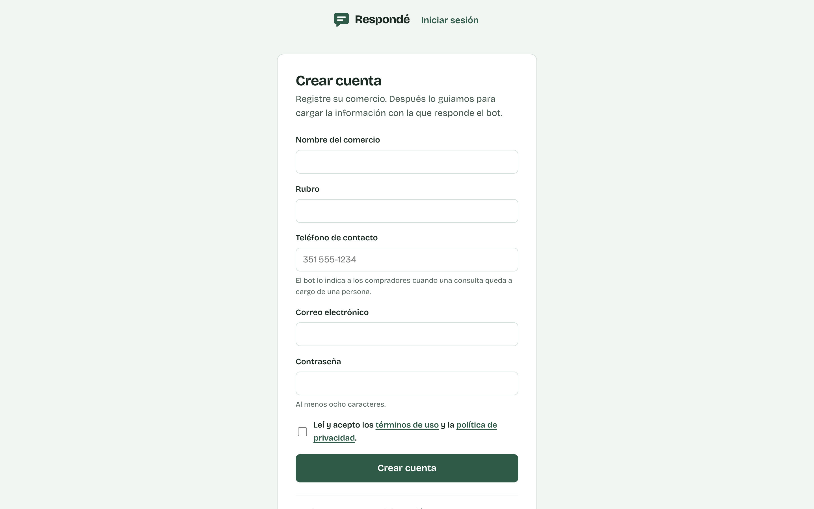
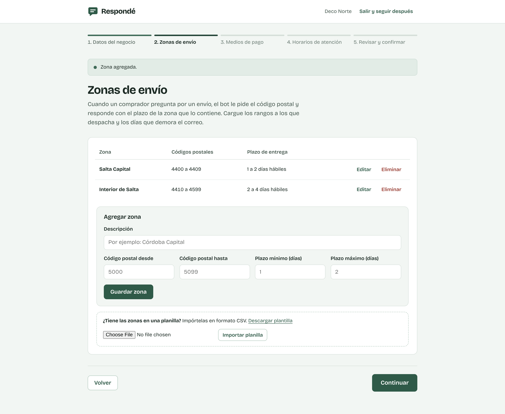
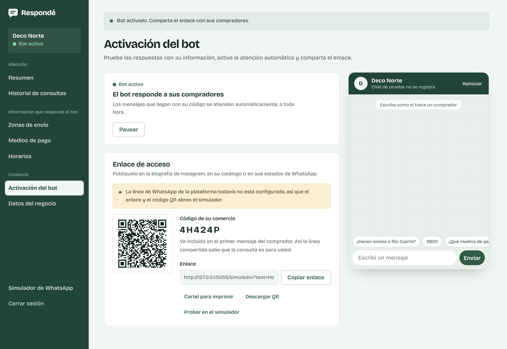

# Manual de uso del panel de administración

Este manual está dirigido al responsable del comercio. Explica cómo registrarse, cargar la información con la que
responde el bot, activarlo y hacer el seguimiento de las consultas. No requiere conocimientos técnicos.

## 1. Crear la cuenta

1. Ingrese a la página de la plataforma y elija **Crear cuenta**.
2. Complete el nombre del comercio, el rubro, un teléfono de contacto, su correo electrónico y una contraseña de al
   menos ocho caracteres.
3. Elija **Crear cuenta**. La sesión queda iniciada y el sistema lo lleva al primer paso de la configuración.

El teléfono de contacto es el número desde el que su equipo responde las consultas que el bot no puede resolver. El
bot se lo indica al comprador en esos casos.

## 2. Configurar el comercio (cuatro pasos)

La configuración se hace una sola vez, en cuatro pasos. Si la interrumpe, la próxima vez que ingrese el sistema
retoma desde el paso pendiente. Puede volver a un paso anterior con **Volver** o con el nombre del paso en la parte
superior.

**Paso 1. Datos del negocio.** Revise los datos del registro. Si tiene un catálogo (Instagram, tienda en línea o un
PDF), agregue el enlace o su usuario de Instagram («@sucomercio»): el bot lo comparte cuando le piden ver los
productos. Elija **Confirmar y continuar**.

**Paso 2. Zonas de envío.** Cargue cada rango de códigos postales al que despacha, con el plazo mínimo y máximo de
entrega en días hábiles y, si quiere, el costo del envío. Por ejemplo: «Córdoba Capital», del 5000 al 5099, de 1 a 2
días, $4.500. Dos zonas no pueden compartir códigos postales.

- El costo es opcional. Escriba 0 si el envío a esa zona es gratis; si lo deja vacío, el bot informa solo el plazo y,
  si un comprador pregunta el costo, le pasa la consulta a usted.
- Debajo de las zonas puede indicar desde qué monto de compra el envío es gratis. El bot lo menciona junto al costo.
- Los compradores pueden escribir su ciudad en lugar del código postal («¿llegan a Río Cuarto?»): el bot usa el código
  postal de esa ciudad para buscar la zona.

Si ya tiene las zonas en una planilla:
1. Elija **Descargar plantilla** y complétela en Excel, una zona por fila. La columna del costo es opcional.
2. Guárdela como CSV y elíjala con **Importar planilla**.
3. El sistema muestra las filas válidas y las observadas, con el motivo. Elija **Incorporar** para sumar las válidas.

**Paso 3. Medios de pago.** Elija cada medio de la lista y, si quiere, agregue un detalle: el alias para
transferencias, las cuotas disponibles, las marcas de tarjeta o las billeteras que acepta. Con **Otro** puede nombrar
un medio que no está en la lista. El detalle importa: si un comprador pregunta «¿aceptan Naranja?» y usted cargó
«Tarjeta de crédito: Visa y Mastercard», el bot responde que no; si no nombró las marcas, responde que no tiene ese
dato y le sugiere consultarle a usted.

**Paso 4. Horarios de atención.** Marque los días que atiende e indique el horario. Si hace jornada partida, use
**Agregar franja** para sumar el horario de la tarde. **Copiar a los días hábiles** repite el horario de un día de
lunes a viernes.

**Revisar y confirmar.** El sistema muestra todo lo cargado. Elija **Confirmar e ir a la activación**.

## 3. Probar y activar el bot

En **Activación del bot** hay un chat de prueba que responde con la información de su comercio. Escriba como si fuera
un comprador, por ejemplo «¿Hacen envíos a Río Cuarto?» o «¿aceptan Mercado Pago?», o toque los botones que aparecen
debajo de la bienvenida. Lo que escriba en este chat no se registra. Si una consulta se derivaría a usted, el chat lo
avisa con una nota.

Si una respuesta tiene un dato incorrecto, corríjalo en la sección correspondiente y vuelva a probar.

Cuando las respuestas sean correctas, elija **Activar bot**. El sistema genera:

- el **código de su comercio**, por ejemplo `CASA26`;
- el **enlace de acceso** a la línea de WhatsApp de la plataforma, que ya incluye el código;
- un **código QR** y un **cartel para imprimir**.

## 4. Compartir el enlace

Publique el enlace en la biografía de Instagram, en su catálogo o en sus estados de WhatsApp. Cuando un comprador lo
abre, WhatsApp le propone un primer mensaje con el código: así la línea compartida sabe que la consulta es para su
comercio. El cartel imprimible sirve para pegar en el depósito o en los paquetes.

## 5. Seguimiento diario

**Resumen.** Es la pantalla inicial. Muestra, para el período elegido, cuántas consultas recibió el bot, cuántas
resolvió sin intervención, cuántas llegaron con el comercio cerrado y cómo se reparten por tema.

**Consultas pendientes.** Son las que necesitan a una persona. Cada una indica su tema:

- **Productos y precios:** stock, precios, medidas o colores.
- **Pedidos realizados:** el estado de una compra ya hecha.
- **Reclamos:** un producto roto, un pedido que no llegó, un cobro duplicado.
- **Pagos informados:** el comprador avisa que pagó; hay que verificar el pago.
- **Envíos, medios de pago u horarios:** cuando falta un dato (una zona sin cargar, un costo sin informar).
- **Otras consultas:** cualquier otra pregunta, o un comprador que pidió hablar con una persona.

Para cada una:

1. Elija **Responder por WhatsApp**: se abre la conversación con el comprador en su WhatsApp habitual.
2. Cuando la haya respondido, elija **Marcar como atendida**. La consulta sale del listado.

El bot ya le dijo al comprador que le va a escribir alguien desde su número y cuándo (si su comercio está cerrado, le
indica el horario de apertura). Mientras la consulta está pendiente, el bot sigue respondiendo a ese comprador lo que
sabe resolver (envíos, pagos, horarios) y, a cualquier otro mensaje, le recuerda una vez que usted le va a escribir.
Todo lo que el comprador escriba queda en la conversación, que puede ver desde **Ver conversación**.

**Historial de consultas.** Lista todas las consultas, de la más reciente a la más antigua. Puede filtrar por fechas,
tema y resultado, y abrir cada una para ver la conversación completa.

## 6. Mantener la información actualizada

Las secciones **Zonas de envío**, **Medios de pago**, **Horarios**, **Respuestas frecuentes** y **Datos del negocio**
permiten modificar la información en cualquier momento. El bot usa los cambios desde la siguiente consulta.

Un medio de pago **desactivado** se conserva en el listado, pero el bot deja de informarlo. Sirve, por ejemplo, para
suspender el pago en efectivo durante las vacaciones.

## 7. Respuestas frecuentes propias

Además de envíos, pagos y horarios, el bot puede responder otras preguntas que usted contesta siempre igual: cambios y
devoluciones, factura, retiro en persona, ventas por mayor, garantía o envoltorio para regalo. Se cargan en
**Respuestas frecuentes**.

1. Elija una **plantilla** o **Nueva respuesta**. La plantilla trae las palabras clave más comunes y un texto de
   ejemplo: cambie el texto por sus condiciones reales antes de guardarlo.
2. Complete la **pregunta que responde** (solo la ve usted), las **palabras clave** separadas por comas, como las
   escribiría un cliente («hacen factura, factura A, IVA»), y la **respuesta del bot**. Para resaltar una parte,
   enciérrela entre asteriscos: \*30 días\*.
3. Antes de guardar, use **Probar con un mensaje**: escriba una pregunta como la haría un cliente y vea si el bot usa
   la respuesta o qué haría en cambio. No se guarda nada.
4. Elija **Guardar respuesta**. El bot la usa desde la próxima consulta.

Algunas palabras no se pueden usar porque el bot ya las usa para otra cosa: las de envíos, medios de pago, horarios y
contacto (las responde con la información que usted cargó), las de reclamos y pagos informados (esas consultas
siempre le llegan a usted), los saludos y los nombres de localidades. El formulario le avisa cuál y por qué. La
respuesta solo puede incluir enlaces a su catálogo.

El listado muestra cuántas consultas resolvió cada respuesta en los últimos 30 días. Si el bot le pasó consultas que
una plantilla habría respondido, aparecen como **Sugerencias según sus consultas**. Una respuesta **desactivada** se
conserva, pero el bot no la usa; al **eliminarla**, las consultas que respondió siguen en el historial.

## 8. Pausar el bot

En **Activación del bot**, **Pausar** detiene la atención automática. Quienes escriban reciben un aviso con el
teléfono de contacto del comercio. **Reactivar bot** vuelve a encenderlo con el mismo código y el mismo enlace.

## Preguntas frecuentes

**¿Qué consultas responde el bot?** Envíos (plazo y costo según el código postal o la ciudad), medios de pago
(incluso si acepta uno en particular), horarios de atención, su teléfono de contacto, el enlace a su catálogo y las
respuestas frecuentes que usted cargue (cambios, factura, retiro, ventas por mayor). Entiende errores de tipeo,
abreviaturas y varias preguntas en un mismo mensaje.

**¿Qué pasa con las demás preguntas?** El bot avisa al comprador que una persona del comercio le va a responder, con
un mensaje que corresponde al tema (por ejemplo, ante un reclamo pide el número de pedido), y la consulta queda
pendiente en el resumen.

**¿El comprador sabe que habla con un bot?** Sí. El bot se presenta como el asistente automático del comercio y, si le
preguntan, lo confirma. En cualquier momento el comprador puede escribir «persona» para que lo atienda alguien.

**¿Tengo que tramitar algo con WhatsApp?** No. La línea la provee la plataforma.

**¿Otro comercio puede ver mis datos?** No. Cada comercio ve solamente su información y sus consultas.

**Olvidé la contraseña.** En esta versión del prototipo no hay recuperación automática; la restablece el administrador
de la plataforma.
